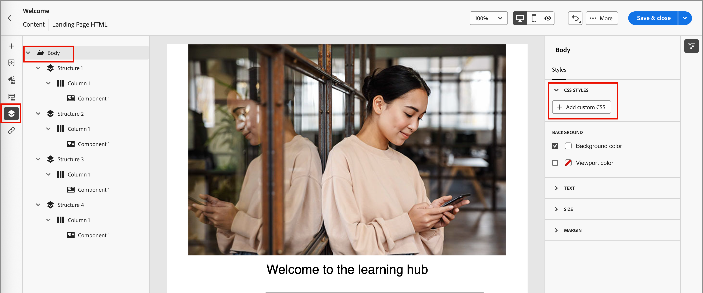
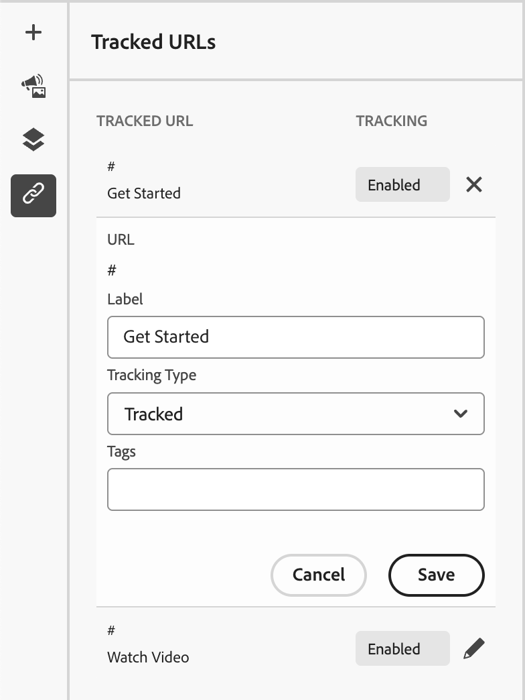
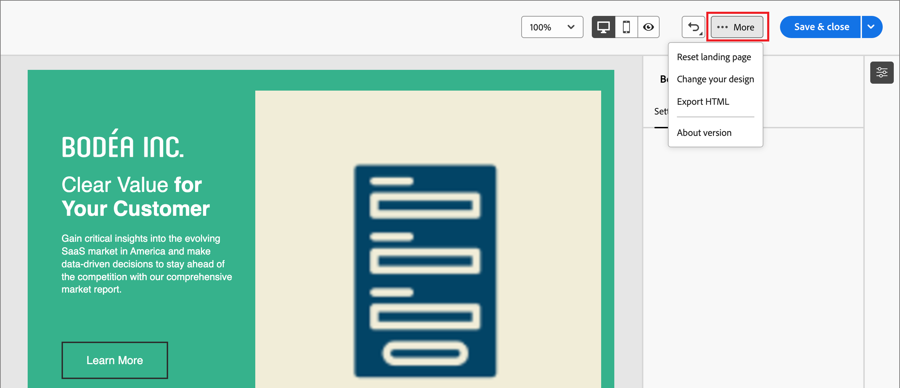

# Création de la page de destination

Après avoir [créé une page de destination](./landing-pages-create-publish.md#create-landing-page), utilisez l’espace de conception visuelle pour définir la disposition et le contenu de votre page.

## Ajout de modules

{{$include /help/_includes/content-design-modules.md}}

## Ajouter la structure et le contenu {#structure-content-landing-page}

{{$include /help/_includes/content-design-components-prime.md}}

### Ajouter un CSS personnalisé {#add-custom-css}

Vous pouvez ajouter votre propre CSS personnalisé directement dans l’espace de conception de la page de destination. Utilisez le CSS personnalisé pour appliquer un style avancé et spécifique, pour une plus grande flexibilité et un meilleur contrôle de l’aspect de votre contenu. Il est recommandé d’ajouter ce style de niveau supérieur avant d’inclure des composants, tels que des images, des boutons et du texte.

Avec au moins un composant de contenu dans la zone de travail, sélectionnez le composant **[!UICONTROL Body]** dans l’arborescence de navigation de gauche pour accéder à l’éditeur CSS personnalisé.

{width="800" zoomable="yes"}

Voir [Ajouter une page CSS personnalisée pour votre contenu](./design-custom-css.md) pour connaître les étapes, les règles de syntaxe et la résolution des problèmes.

### Ajout de ressources {#add-assets}

Dans l’espace de conception visuelle, sélectionnez l’icône _Assets_ (  ) dans la barre de navigation de gauche pour parcourir et sélectionner des ressources d’image dans la bibliothèque de ressources [!DNL Marketo Optimizer].

Pour connaître les étapes de sélection, de remplacement ou de chargement de ressources d’image, consultez [Utilisation de ressources pour la création de contenu](./digital-asset-management.md#assets-authoring).

### Ajouter des formulaires {#add-forms}

{{$include /help/_includes/content-design-add-forms.md}}

### Parcourir les calques, paramètres et styles {#navigate-layers-settings-styles}

{{$include /help/_includes/content-design-navigation.md}}

### Personnaliser le contenu {#personalize-content}

[!DNL Marketo Optimizer] utilise la syntaxe Handlebars pour la personnalisation. Les jetons sont remplacés par des valeurs issues des données de profil de chaque visiteur lors de l’affichage de la page de destination.

_Pour ajouter de la personnalisation :_

1. Sélectionnez le composant de texte et cliquez sur l’icône _Ajouter une personnalisation_ (  ) dans la barre d’outils.
1. Dans la boîte de dialogue de personnalisation, parcourez l’arborescence du schéma à gauche et sélectionnez un attribut. L’éditeur insère l’expression Handlebars correspondante.
1. Ajoutez une valeur de secours pour gérer les données manquantes, si nécessaire.
1. Cliquez sur **[!UICONTROL Confirmer]** ou **[!UICONTROL Insérer]**. L’expression apparaît en ligne dans le champ.

Pour plus d’informations sur les outils et la syntaxe de l’éditeur d’expression, voir [Éditeur Personalization](./personalization-expressions.md).

### Modifier le tracking des URL liées {#linked-url-tracking}

{{$include /help/_includes/content-design-links.md}}

{width="400"}

Utilisez le **[!UICONTROL Type de suivi]** pour contrôler le suivi du lien :

* **[!UICONTROL Tracké]** - Active le tracking sur l&#39;URL du lien.
* **[!UICONTROL Jamais]** - N’active jamais le suivi de l’URL du lien.

### Enregistrer votre travail {#save-your-work}

Cliquez sur **[!UICONTROL Enregistrer]** à tout moment pour enregistrer le brouillon de la page de destination.

Vous pouvez continuer à apporter des modifications au brouillon de page. Lorsque vous êtes prêt à afficher la page et à la rendre disponible pour liaison dans un e-mail ou un SMS, vous pouvez publier la page.

### Afficher les options {#view-options}

Tirez parti des options d’affichage et de validation du contenu disponibles dans l’espace de conception visuelle.

* Effectuez un zoom avant/arrière sur le contenu dans les options de zoom prédéfinies.

* Basculez vers l’affichage du contenu sur les ordinateurs de bureau, les appareils mobiles ou en texte seul/texte brut.
  * Cliquez sur l’icône _Afficher_ pour obtenir un aperçu du contenu sur tous les appareils.
  * Sélectionnez l’un des appareils prêts à l’emploi ou saisissez des dimensions personnalisées pour prévisualiser le contenu.

### Plus d’options {#more-options}

Dans le menu _[!UICONTROL Plus...]_ situé en haut de l’espace de conception visuelle, vous pouvez effectuer les actions suivantes :

{width="500"}

* **[!UICONTROL Réinitialiser la page de destination]** - Cliquez sur cette option pour vider la zone de travail de conception visuelle de sa substance et recommencer à créer le contenu de votre page.
* **[!UICONTROL Modifier votre conception]** - Revenez à la page d’accueil _[!UICONTROL Créer votre page de destination principale]_. À partir de là, vous pouvez choisir un autre modèle pour redémarrer le processus de conception ou choisir de concevoir la page à partir de zéro dans une zone de travail vierge.
* **[!UICONTROL Exporter HTML]** - Téléchargez le contenu de la zone de travail visuelle sur votre système local au format HTML compressé sous la forme d’un fichier zip.
