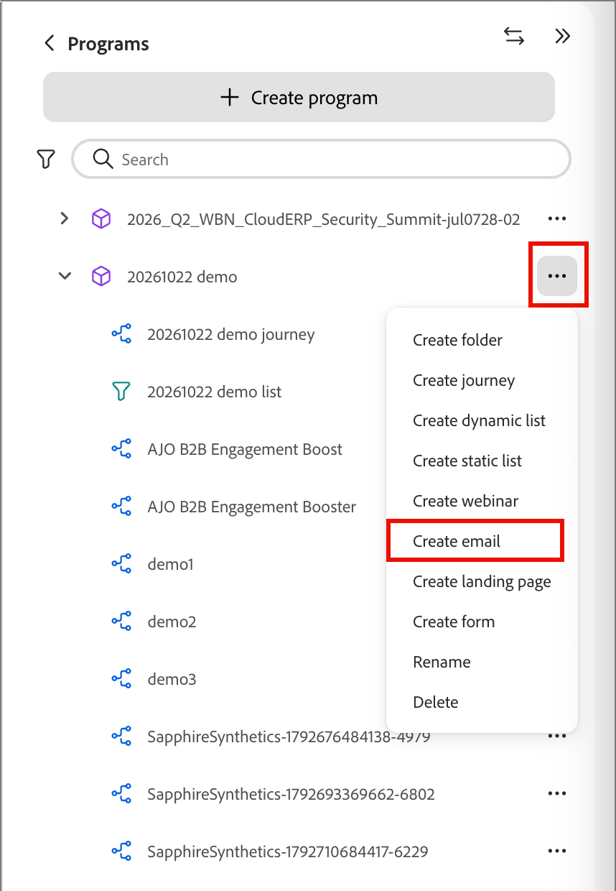
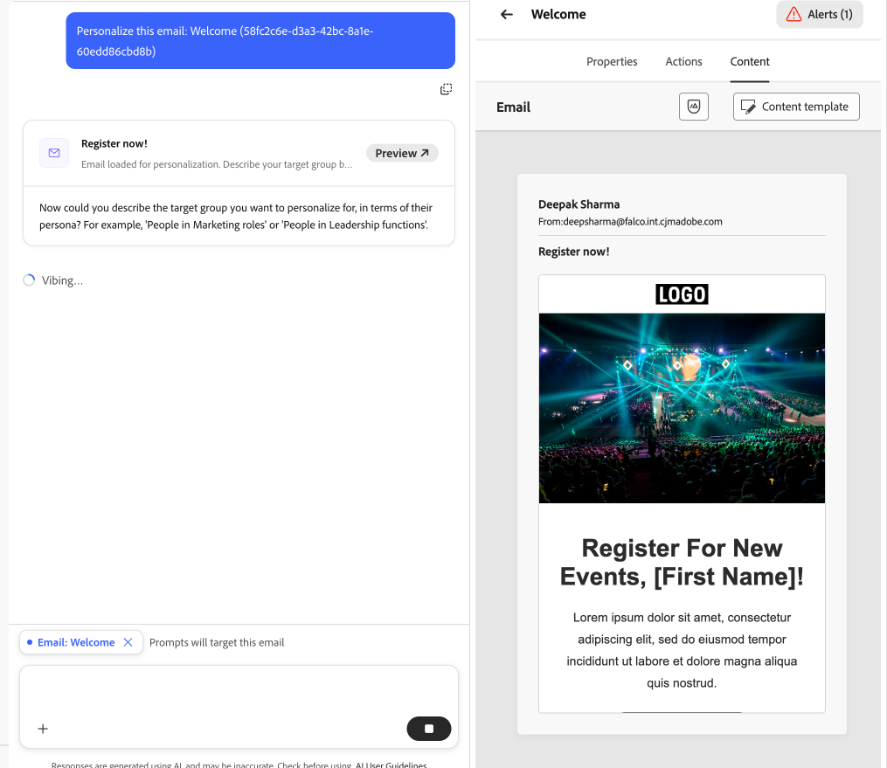

# Créer des e-mails et les ajouter aux parcours

[!DNL Adobe Marketo Optimizer] offre aux spécialistes du marketing B2B une expérience moderne de création et de diffusion d’e-mails de niveau entreprise afin que vous puissiez créer, publier et envoyer des e-mails à partir de vos programmes et parcours.

Les e-mails sont des ressources autonomes, vous n’avez donc pas besoin de parcours pour en créer un. [Créez un e-mail](#create-email-from-programs) dans un programme ou l’un de ses dossiers, [publiez-le](#publish-email) lorsqu’il est prêt, puis [envoyez-le à partir de n’importe quel parcours de ce programme](#add-email-from-journey).

## Cycle de vie des e-mails {#lifecycle}

Un e-mail possède toujours l’un des statuts suivants :

| État | Description |
| ----- | ----------- |
| **Brouillon** | Chaque nouvel e-mail commence par un brouillon, qui s’affiche avec une icône d’enveloppe rouge dans l’arborescence des programmes. Vous pouvez modifier ses propriétés, actions et contenu, et vous pouvez le personnaliser, l’analyser, le renommer ou le supprimer. |
| **Publié** | Un e-mail publié est verrouillé et prêt à être envoyé. Une icône d’enveloppe verte apparaît. Elle ne peut pas être modifiée ni dépubliée et est répertoriée lorsque vous sélectionnez un e-mail dans un parcours. |
| **Dans un parcours** | Lorsque vous sélectionnez un e-mail publié dans une action _Envoyer un e-mail_, une copie publiée appartenant au parcours est créée. La copie est en lecture seule et ne change pas si l’original est ultérieurement dupliqué et révisé. |

Un e-mail passe du statut de brouillon à celui publié lorsque vous le publiez. Lorsqu’il est sélectionné pour un nœud d’action _Envoyer un e-mail_, une copie réside dans le parcours. Pour modifier un email publié, [dupliquez-le](#duplicate-email). Le duplicata est créé en tant que brouillon avec le même contenu et les mêmes paramètres.

{width="800" zoomable="yes"}

L’état de l’e-mail détermine la disponibilité de l’action :

| Action | Brouillon | Publié | Dans un parcours |
| ------ | ----- | --------- | ------------ |
| Modifier les propriétés, les actions et le contenu | Oui | Non | Non |
| Personnaliser l’e-mail | Oui | Non | Non |
| Analyser l’e-mail | Oui | Non | Non |
| Publier | Oui, une fois les alertes de blocage résolues | Déjà publié | Publié automatiquement |
| Dupliquer | Oui | Oui | Non |
| Renommer | Oui | Non | Non. Vous donnez un nom à la copie lorsque vous la sélectionnez. |
| Supprimer | Oui | Non | Non. Supprimez plutôt le nœud _Envoyer un e-mail_ . |
| Sélectionner dans un parcours | Non | Oui | Non applicable |

## Conditions préalables {#before-you-begin}

Assurez-vous que votre rôle d’utilisateur inclut les [autorisations de produit](../start/permissions-reference.md) suivantes pour les tâches que vous effectuez :

* **[!UICONTROL Afficher les programmes B2B]** et **[!UICONTROL Afficher les dossiers B2B]** - Affichez les programmes et les dossiers où se trouvent les e-mails.
* **[!UICONTROL Afficher les e-mails B2B]** - Afficher les e-mails.
* **[!UICONTROL Gérer les e-mails B2B]** - Créez, modifiez, dupliquez, renommez, supprimez et publiez des e-mails.
* **[!UICONTROL Gérer les Parcours de personne B2B]** - Ajoutez ou remplacez des actions d’e-mail dans un parcours de personne. Pour accéder aux parcours en lecture seule, utilisez **[!UICONTROL Afficher les Parcours de personne B2B]**.
* **[!UICONTROL Gérer l’expérience de conversation B2B]** - Accédez aux [!DNL Coworker] pour personnaliser ou analyser un e-mail. Les actions dans [!DNL Coworker] nécessitent également les autorisations de messagerie correspondantes.

Des autorisations supplémentaires ne sont requises que si vous effectuez les tâches de configuration ou d’envoi associées suivantes :

* **[!UICONTROL Gérer les programmes B2B]** - Créez un programme s’il n’existe pas déjà.
* **[!UICONTROL Gérer les configurations des canaux B2B]** et **[!UICONTROL Afficher les paramètres d’e-mail B2B]** - Créez une configuration de canal e-mail. Les administrateurs ont également besoin de **[!UICONTROL Gérer les paramètres d’e-mail B2B]** pour configurer les paramètres de diffusion e-mail.
* **[!UICONTROL Publier les Parcours de personne B2B]** - Publiez le parcours qui envoie l’e-mail.

Avant de créer un email, vérifiez les points suivants :

* Les e-mails résident dans un programme ou l’un de ses dossiers. Définir le programme avant de créer un e-mail Un parcours ne peut envoyer des e-mails qu&#39;à partir de son propre programme.
* Pour sélectionner une configuration de canal e-mail, utilisez l’onglet e-mail **[!UICONTROL Actions]**. Les administrateurs gèrent [configuration du canal e-mail](../admin/email-channel-configuration.md).
* Vous pouvez créer autant d’e-mails que nécessaire dans un programme.

>[!NOTE]
>
>Si vous envoyez un e-mail pour la première fois, assurez-vous que [délivrabilité des e-mails](../start/email-deliverability.md) et le [canal e-mail](../admin/email-channel-configuration.md) nécessaire sont configurés.

<!-- 
* **Email channel configurations** - Manage the sender identity, reply behavior, marketing vs. transactional message types, and tracking.
* **Email deliverability controls** - Set up your email deliverability channel, including subdomain delegation (Fully Delegated and CNAME methods), DMARC, SPF/DKIM auto-configuration, and shared IP pool support.
* **Send Email action** - From a journey, add a _Send email_ action node, including personalization using profile attributes (Handlebars syntax).
* **Visual drag-and-drop email design tools** -  Design your email content with structures, content components, themes, dark-mode support, and reusable visual fragments.
* **Marketo Design Studio assets** — Choose images and assets from a one-time copy of your Marketo Engage asset library directly inside the email canvas.
* **Reusable templates and fragments** — Save common headers, footers, CTAs, and full email layouts and reuse them across journeys.
* **Role-Based Access Control (RBAC)** — Apply granular permissions for creating, editing, approving, and sending email. 
-->

>[!BEGINSHADEBOX]

## Limites actuelles {#limitations}

* **Les profils de test, Simuler du contenu et Envoyer un BAT** ne sont pas disponibles dans la version actuelle. Le rendu Litmus et les rapports de spam basés sur SpamAssassin sont prévus pour une prochaine version.
* **La personnalisation au niveau du compte et les données d’objet personnalisé** ne sont pas disponibles dans la version actuelle. Utilisez les attributs de profil.
* **migration automatisée Velocity-to-Handlebars** des modèles de [!DNL Marketo Engage] existants est disponible sur demande.
* **Commentaires par e-mail et collaboration** (commentaires intégrés, @mentions, workflow de révision de la demande) sont prévus pour une version ultérieure.
* Les intégrations d’**AEM Assets, de fragments de contenu AEM et d’Adobe Express** sont prévues pour une version ultérieure.

>[!ENDSHADEBOX]

## Principaux concepts {#key-concepts}

Avant de créer des e-mails pour les parcours de personne et de créer du contenu d’e-mail, passez en revue les concepts suivants :

| Concept | En [!DNL Adobe Marketo Optimizer] |
| ------- | ---------------------- |
| **_[Espace de conception des emails](../content/email-authoring.md#email-design-tools)_** | Canevas visuel et outils de conception utilisés pour composer du contenu d’e-mail. Il comprend des composants de disposition à glisser-déposer, des modèles, des fragments, des thèmes et un éditeur de personnalisation. |
| **_[Modèle](../content/templates.md)_** | Disposition d’e-mail réutilisable disponible pour la création d’un e-mail. Il peut s’agir d’un modèle type intégré fourni par Adobe ou d’un modèle personnalisé créé par votre équipe. |
| **_[Fragment visuel](../content/fragments.md)_** | Bloc de contenu réutilisable (par exemple, en-tête, pied de page, CTA, clause de non-responsabilité) pouvant être inséré dans plusieurs e-mails. La mise à jour d’un fragment propage la modification à chaque e-mail qui l’utilise. |
| **_[Thème](../content/email-authoring.md#design-from-scratch)_** | Paramètre prédéfini de style réutilisable (couleurs, typographie, espacement, styles de bouton) appliqué à un e-mail. |
| **_[Jeton](../content/personalization-expressions.md)_** | Une expression Handlebars, par exemple `{{profile.firstName}}`, résolue au moment de l’envoi à l’aide des données de profil de chaque destinataire. |
| **_[E-mail autonome](#lifecycle)_** | Ressource e-mail qui existe indépendamment de tout parcours. Il est créé dans un programme ou l’un de ses dossiers et passe de brouillon à publié. |
| **_[Type d&#39;email](#email-types)_** | Classification choisie lors de la création d’un e-mail, **[!UICONTROL Marketing]** ou **[!UICONTROL Transactionnel]**. Il [!DNL Marketo Optimizer] indique comment traiter le message à des fins de consentement. |
| **_[Action Envoyer un e-mail](./action-nodes.md#add-an-action-node)_** | Nœud d’action de parcours qui utilise une configuration de canal et du contenu d’e-mail pour diffuser un e-mail. |

## Types d’e-mails {#email-types}

Lorsque vous créez un e-mail, vous choisissez son type. Le type [!DNL Marketo Optimizer] indique comment traiter le message à des fins de consentement. Par conséquent, choisissez celui qui correspond à la raison pour laquelle vous l’envoyez.

| Type | Utiliser pour |
| ---- | ------- |
| **[!UICONTROL Marketing]** | Messages promotionnels, tels qu’une annonce de lancement de produit, une newsletter ou une invitation à un événement. |
| **[!UICONTROL Transactionnel]** | Messages opérationnels qu’une personne attend en raison d’une action qu’elle a effectuée, tels qu’une commande, un enregistrement ou une confirmation d’expédition. |

Le type apparaît comme e-mail **[!UICONTROL Catégorie]** dans l’onglet **[!UICONTROL Propriétés]**.

## Créer un email dans l&#39;arborescence des programmes {#create-email-from-programs}

Créez un e-mail dans un programme ou un dossier pour le créer indépendamment de tout parcours.

1. Dans le volet de navigation de gauche, développez **[!UICONTROL Marketing Management]** et sélectionnez **[!UICONTROL Programmes]**.

1. Dans l&#39;arborescence des programmes, cliquez sur l&#39;icône _Plus_ (**...**) en regard du programme ou du dossier dans lequel vous souhaitez créer l’e-mail, sélectionnez **[!UICONTROL Créer un e-mail]**.

   {width="400"}

1. Dans la boîte de dialogue _[!UICONTROL Créer un e-mail]_, renseignez les champs suivants :

   * **[!UICONTROL Parent]** - (Obligatoire) Programme ou dossier dans lequel l’e-mail est enregistré. Il est défini sur le programme à partir duquel vous avez démarré et vous pouvez le remplacer par un autre programme ou par l&#39;un des dossiers du programme.

   * **[!UICONTROL Type d’e-mail]** - Sélectionnez **[!UICONTROL Marketing]** ou **[!UICONTROL Transactionnel]** (voir [Types d’e-mail](#email-types)).

   * **[!UICONTROL Nom]** - (Obligatoire) Saisissez un nom qui identifie l’e-mail dans l’arborescence des programmes.

   * **[!UICONTROL Description]** - (Facultatif) Saisissez une note pour votre équipe à propos de l’e-mail et de son objectif.

   {width="400"}

1. Cliquez sur **[!UICONTROL Créer]**.

L’e-mail s’ouvre dans son propre onglet et apparaît sous le programme dans l’arborescence des programmes en tant que brouillon. Lorsqu’un e-mail est ouvert, toutes les invites de [!DNL Coworker] sont incluses dans cet e-mail.

Ensuite, [configurer l’e-mail](#define-email-properties), [résoudre les alertes](#alerts) et [le publier](#publish-email).

### Définir les propriétés et les actions de l’e-mail {#define-email-properties}

Un e-mail de brouillon comporte trois onglets : **[!UICONTROL Propriétés]**, **[!UICONTROL Actions]** et **[!UICONTROL Contenu]**. Examinez-les dans l’ordre, puis enregistrez vos modifications. La page d’e-mail s’ouvre lorsque vous créez un e-mail dans l’arborescence des programmes. Pour ouvrir un brouillon ultérieurement, sélectionnez l’e-mail dans l’arborescence des programmes.

#### Renseignez les onglets Propriétés et Actions . {#properties-actions-tabs}

1. (Facultatif) Dans l’onglet **[!UICONTROL Propriétés]**, saisissez une **[!UICONTROL Description]** ainsi que toute autre information descriptive que vous souhaitez capturer pour l’e-mail.

   {width="800" zoomable="yes"}

1. Sélectionnez l’onglet **[!UICONTROL Actions]** et renseignez les paramètres fonctionnels de l’e-mail :

   * **[!UICONTROL E-mail]** - Sélectionnez ou créez une **[!UICONTROL configuration du canal e-mail]** à utiliser.

     Il s’agit de l’ensemble réutilisable de paramètres de diffusion par e-mail qui définit l’identité de l’expéditeur, l’adresse de réponse, le sous-domaine, le groupe d’adresses IP, le type d’e-mail (marketing ou transactionnel) et le suivi. Cliquez sur l’icône _Affichage_ pour passer en revue les paramètres de la configuration sélectionnée.

     Les administrateurs créent des configurations dans [configuration du canal e-mail](../admin/email-channel-configuration.md).

   * **[!UICONTROL Règles métier]** - (Facultatif) Appliquez des règles de limitation ou d’interruption à votre action d’e-mail en sélectionnant un ensemble de règles.

     Pour plus d’informations sur les règles métier et sur la définition et l’activation d’ensembles de règles pour les communications de canal, voir [_Règles métier_](../admin/business-rules.md).

   * **[!UICONTROL Suivi des actions]** - Cochez les cases correspondant aux actions que vous souhaitez suivre pour l’e-mail.

   {width="600" zoomable="yes"}

#### Ajouter l’objet et le contenu {#content-tab}

1. Cliquez sur **[!UICONTROL Modifier le contenu]** ou sélectionnez l’onglet **[!UICONTROL Contenu]**.

   {width="500" zoomable="yes"}

1. Saisissez le texte **[!UICONTROL Objet]** que vous souhaitez afficher dans le champ Objet de l’e-mail.

   L’objet est obligatoire.

   Cliquez sur l’icône _Personnaliser_ (  ) pour utiliser un jeton de personnalisation dans le champ.

1. (Facultatif) Cochez la case **[!UICONTROL Optimiser la taille d’HTML]** pour réduire la taille de votre HTML de messagerie pendant le processus de publication.

   Cela permet d’éviter l’extraction d’e-mails dans les clients tels que Gmail. Gmail tronque les messages de plus de 100 Ko. Pour plus d’informations, voir [_Optimiser la taille de l’e-mail HTML_](#optimize-html-size).

1. Cliquez sur **[!UICONTROL Modifier le corps de l’e-mail]** pour accéder aux outils de conception visuelle et commencer [à créer votre contenu](../content/email-authoring.md).

   Vous pouvez également cliquer sur **[!UICONTROL Éditeur de code]** pour coder votre propre contenu dans HTML brut. Si vous disposez déjà d’HTML à réutiliser pour votre conception d’e-mail, vous pouvez le copier et le coller dans l’éditeur.

### Vérifier les alertes {#alerts}

Le bouton **[!UICONTROL Alertes]** dans l’en-tête de l’e-mail indique le nombre de problèmes détectés par [!DNL Adobe Marketo Optimizer]. Cliquez dessus pour afficher la liste.

{width="450"}

Les alertes peuvent être de deux types :

* **Blocage des problèmes** - Bien que l’un de ces problèmes persiste, l’option **[!UICONTROL Publier]** n’est pas disponible et le menu _Plus_ de l’e-mail affiche **[!UICONTROL Résoudre les alertes par e-mail pour la publication]**. Résolvez tous les problèmes de blocage avant de publier l’e-mail.

  Par exemple :

  * Le nom de l’expéditeur est vide
  * Objet manquant
  * Le contenu de l’e-mail est vide

* **Avertissements** - Ces éléments méritent d’être examinés, mais ne vous empêchent pas de les publier. Un e-mail peut afficher une alerte et être publié si les alertes restantes sont des avertissements.

  Par exemple :

  * Le lien d’exclusion n’est pas présent dans le corps de l’e-mail.
  * La version texte d’HTML est vide.
  * Liens vides détectés
  * E-mail dépasse 100 000

## Gérer les e-mails dans l’arborescence des programmes {#manage-emails}

Les e-mails s’affichent dans l’arborescence des programmes avec une icône d’enveloppe. Une enveloppe rouge marque un brouillon. Une enveloppe verte marque un e-mail publié. Cliquez sur l’icône _Plus_ (**...**) à côté d’un e-mail pour le gérer.

{width="400"}

Le menu d’un brouillon d’e-mail comprend **[!UICONTROL Publier]**, **[!UICONTROL Personnaliser l’e-mail]**, **[!UICONTROL Analyser l’e-mail]**, **[!UICONTROL Dupliquer]**, **[!UICONTROL Renommer]** et **[!UICONTROL Supprimer]**.

Pour un e-mail publié, **[!UICONTROL Dupliquer]** est la seule option.

### Personnaliser et analyser un email {#personalize-analyze}

Bien qu’un e-mail soit un brouillon, son menu _Plus_ comprend deux outils de contenu. Exécutez-les avant la publication, car un e-mail publié ne peut pas être modifié.

* **[!UICONTROL Personnaliser l’e-mail]** - Ouvre le [!DNL Coworker] avec l’e-mail chargé. Pour ajouter du contenu personnalisé à l’e-mail, décrivez le groupe cible. Voir [_Personnaliser le contenu d’un e-mail par persona_](../agents/personalize-content.md) pour plus d’informations.

  {width="700" zoomable="yes"}

* **[!UICONTROL Analyser l’e-mail]** - Vérifie le contenu que vous avez déjà créé. Voir [&#x200B; Analyser un e-mail existant](../agents/personalize-content.md#analyze-existing-email).

### Publier un e-mail {#publish-email}

Publiez un e-mail lorsqu’il est prêt à être envoyé. Seuls les e-mails publiés sont répertoriés lorsque vous [sélectionnez un e-mail dans un parcours &#x200B;](#add-email-from-journey).

1. Assurez-vous que l’e-mail ne comporte aucune alerte [bloquante](#alerts).

1. Dans l&#39;arborescence des programmes, cliquez sur l&#39;icône _Plus_ (**...**) en regard de l’e-mail et sélectionnez **[!UICONTROL Publier]**.

1. Dans la boîte de dialogue de confirmation _[!UICONTROL Publier l’e-mail]_, cliquez sur **[!UICONTROL Publier]**.

   {width="400"}

L’icône d’e-mail devient verte. Si vous sélectionnez l’e-mail, il s’ouvre dans une vue en lecture seule qui résume son contenu, ses propriétés et ses actions.

{width="700" zoomable="yes"}

>[!IMPORTANT]
>
>La publication est permanente. Un e-mail publié ne peut pas être modifié, renommé, supprimé ou renvoyé au brouillon. Pour apporter des modifications, [dupliquez l’e-mail](#duplicate-email).

### Dupliquer un email {#duplicate-email}

Pour modifier un e-mail publié, dupliquez-le. Pour essayer une variation sans modifier l’original, vous pouvez également dupliquer un brouillon.

1. Dans l&#39;arborescence des programmes, cliquez sur l&#39;icône _Plus_ (**...**) en regard de l’e-mail et sélectionnez **[!UICONTROL Dupliquer]**.

1. Dans la boîte de dialogue _[!UICONTROL Dupliquer l’e-mail]_, modifiez le **[!UICONTROL Nom]** si nécessaire.

   Il prend par défaut le nom d’origine suivi de `_copy`. Vous pouvez éventuellement ajouter une **[!UICONTROL Description]**.

   {width="400"}

1. Cliquez sur **[!UICONTROL Dupliquer]**.

Le duplicata est créé en tant que brouillon avec le même contenu et les mêmes paramètres. Apportez vos modifications, puis publiez-les.

## Ajout d’un e-mail à un parcours {#add-email-from-journey}

Pour envoyer un e-mail, ajoutez-le à un parcours dans le même programme. Lorsque vous sélectionnez un e-mail, [!DNL Marketo Optimizer] en fait une copie pour ce parcours et publie automatiquement la copie. Les e-mails proviennent de l’arborescence des programmes. Par conséquent[&#x200B; créez et publiez l’e-mail](#create-email-from-programs) d’abord.

Vous pouvez utiliser le même e-mail dans plusieurs parcours. Chaque fois que vous le sélectionnez, une copie distincte est créée pour ce parcours et vous pouvez donner à chaque copie un nom unique.

### Sélectionner un e-mail pour une action Envoyer un e-mail {#select-email-in-journey}

1. Ouvrez le parcours, puis sélectionnez ou ajoutez un nœud [_Agir_](action-nodes.md#add-an-action-node).

1. Dans _[!UICONTROL Sélectionner une action]_, choisissez **[!UICONTROL Envoyer un e-mail]**.

1. Sous _[!UICONTROL Source de l’e-mail]_, choisissez l’une des options suivantes :

   * **[!UICONTROL Choisir un e-mail dans l’arborescence du programme]** - Sélectionnez cette option pour utiliser un e-mail publié à partir du programme du parcours ou de ses dossiers.

   * **[!UICONTROL Utiliser un e-mail personnalisé par l’IA]** - Sélectionnez cette option pour utiliser un e-mail généré par l’IA. Ces e-mails sont optimisés de sorte que les clients de boîte de réception assistés par l’IA fondent leurs résumés et leurs réponses dans vos offres et appels à l’action.

   {width="600"}

   Le nœud affiche un nom d’e-mail vide jusqu’à ce que vous choisissiez un e-mail.

1. Cliquez sur **[!UICONTROL Sélectionner l’e-mail]**.

   * **_E-mail de l’arborescence de programmes:_** dans la boîte de dialogue _[!UICONTROL Sélectionner un e-mail]_, recherchez et sélectionnez l’e-mail.

     Utilisez **[!UICONTROL Rechercher un e-mail]** pour filtrer si nécessaire. Sélectionnez un e-mail dans la liste pour le prévisualiser et vérifier l’objet.

     {width="600" zoomable="yes"}

     >[!NOTE]
     >
     >La boîte de dialogue répertorie uniquement les e-mails publiés à partir du programme de parcours et de ses dossiers. Les brouillons n’apparaissent pas tant que vous ne les [&#x200B; pas publiés](#publish-email). Si aucun e-mail n’apparaît, vérifiez qu’il comporte une icône publiée (icône verte) et qu’il se trouve dans le bon programme.

     Dans **[!UICONTROL Nom]**, saisissez le nom que l’e-mail doit avoir dans le parcours.

     Il prend par défaut le nom d’origine suivi de `_copy`. Renommez-la pour qu’elle ait un sens dans le contexte du parcours.

   * E-mail personnalisé **_AI:_** dans la boîte de dialogue _[!UICONTROL Sélectionner un e-mail généré par l’IA]_, recherchez et sélectionnez l’e-mail personnalisé.

     Sélectionnez un e-mail personnalisé dans la liste. La boîte de dialogue répertorie les _e-mails personnalisés par l’IA_ stockés dans la bibliothèque d’IA. Pour plus d’informations, voir Personnaliser le contenu d’un e-mail par persona.

     {width="450" zoomable="yes"}

1. Cliquez sur **[!UICONTROL Sélectionner]**.

### Parcours de la copie d’e-mail {#journey-copy}

La copie est ajoutée au parcours, publiée et répertoriée sous le parcours dans l’arborescence des programmes avec une icône orange. Il possède son propre ID d’action et est en lecture seule.

{width="700" zoomable="yes"}

Le parcours conserve sa propre copie. Le contenu et la configuration sont copiés au moment où vous sélectionnez l’e-mail. Si vous dupliquez et modifiez ultérieurement l’original, les parcours existants continuent d’envoyer la version copiée.

Pour l’option facultative [optimisation de l’heure d’envoi](email-send-time-optimization.md), configurez le nœud d’action de parcours après avoir sélectionné l’e-mail.

### Mise à jour d’un email dans un parcours {#update-email-in-journey}

La copie du parcours étant en lecture seule, vous pouvez la remplacer plutôt que de la modifier.

1. [Dupliquer](#duplicate-email) l’e-mail publié d’origine, apportez vos modifications au brouillon et [publiez-le](#publish-email).

1. Dans le parcours, sélectionnez le nœud _Envoyer un e-mail_ et supprimez-le à l’aide de l’icône de la corbeille du panneau _Prendre une mesure_.

1. Ajoutez une nouvelle action _Envoyer un e-mail_ à sa place et sélectionnez l’e-mail mis à jour.

## Optimiser la taille du HTML de l’e-mail {#optimize-html-size}

>[!CONTEXTUALHELP]
>id="ajo-b2b-prime_email_minification"
>title="Réduire la taille du HTML"
>abstract="Activez cette option pour compresser le HTML de votre e-mail lors de la publication en supprimant les espaces blancs, les mises en retrait et les commentaires non indispensables. Cela permet d’éviter l’extraction d’e-mails dans les clients tels que Gmail. Gmail tronque les messages de plus de 100 Ko."

[!DNL Marketo Optimizer] permet de compresser la version HTML de votre e-mail pendant le processus de publication en supprimant les espaces inutiles, la mise en retrait et les commentaires non indispensables. Conserver un contenu HTML de petite taille permet d’effectuer les opérations suivantes :

* Éviter de **couper les e-mails** - Certains clients tels que Gmail tronquent les messages de plus de 100 Ko, ce qui empêche les destinataires de voir le contenu complet.
* Améliorer le **temps de chargement des e-mails** dans la boîte de réception de la personne destinataire.
* Améliorer la **délivrabilité** et réduire l’utilisation de la bande passante.

Cette optimisation n’est pas appliquée automatiquement. Vous devez l’activer dans l’onglet _[!UICONTROL Contenu]_.

<!--  -->

>[!IMPORTANT]
>
> La réduction de la taille du contenu HTML n’est appliquée qu’au moment de la publication.

L’optimisation s’adapte au client de messagerie :

* Elle conserve les commentaires conditionnels MSO/Outlook.
* Elle ne modifie pas le contenu, les images ou les vidéos.

>[!NOTE]
>
>La réduction de la taille de l’e-mail dépend de la structure HTML d’origine de votre e-mail. Si le contenu est déjà compact ou si la payload de l’e-mail est très volumineuse, la réduction peut être minimale et peut ne pas empêcher entièrement l’écrêtage.

<!-- 
Proof and simulate workflows are not available in this release. See [Current limitations](#limitations).

### Test HTML size optimization {#optimize-html-proof}

If you have enabled the [HTML size optimization](#optimize-html-size) option, you can evaluate its impact before publishing when sending proofs. Follow the following steps.

1. In the email design space, click the _Issues_ icon on the top right. If the rendered email size exceeds 100 KB, a message is displayed to warn you that this may cause truncation in some email clients.

1. Click **[!UICONTROL Simulate content]**.

1. To test the optimized version, click the **[!UICONTROL Send proof]** button and select the **[!UICONTROL Optimize HTML size]** option. This will send a proof with the reduced HTML size to your test recipients.

    >[!NOTE]
    >
    >This setting is independent from the email editor — the proof reflects what you select in the proof, regardless of whether the option is enabled or disabled in the email itself.

1. Select the test recipients and click **[!UICONTROL Send proof]**.

1. Back in the **[!UICONTROL Simulate]** screen, click the **[!UICONTROL View Proof]** button.

1. Click the _Information_ icon next to the status of the proof.

   The optimization details are displayed in a pop-up window, including the original HTML size, the optimized HTML size, and the size reduction percentage.
    
    Use this information to validate the optimized output and confirm the email stays within the recommended 100 KB threshold before publishing.

-->
