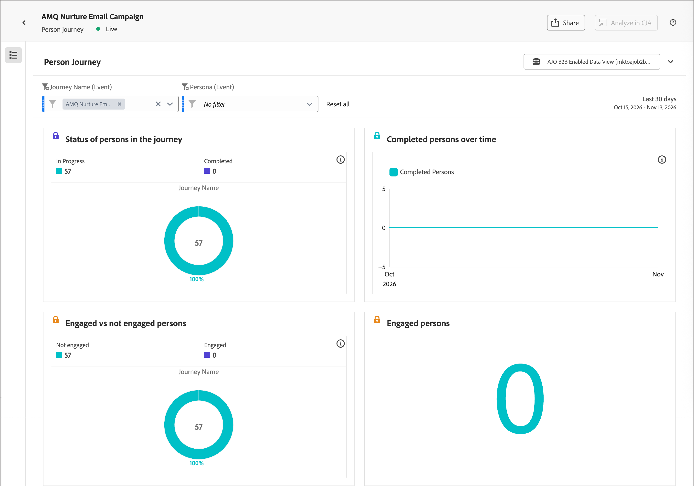

# Rapport Détails du Parcours de la personne

<!-- SPHR-39120: UX plans to move the Journey activity flow tile to the top of the report. Update the tile order in this page when that ships. -->

Cliquez sur **[!UICONTROL Afficher le rapport]** pour un parcours de personne actif ou terminé afin d’afficher ses mesures de performances et son flux d’activité. Après l’ouverture du rapport, vous pouvez sélectionner plusieurs parcours à inclure dans le rapport.

>[!PREREQUISITES]
>
>Pour afficher ce rapport, vous devez disposer de l’autorisation **[!UICONTROL Afficher les rapports de Parcours de personne B2B]** [3&rbrace;.](../start/permissions-reference.md)

_Afficher le rapport :_

1. Ouvrez un parcours de personne **[!UICONTROL Actif]** ou **[!UICONTROL Terminé]** dans la liste des _[!UICONTROL parcours de personne]_.
1. Dans l&#39;en-tête du parcours, sélectionnez **[!UICONTROL Afficher le rapport]**.

   {width="600" zoomable="yes"}

Vous pouvez [modifier la période](./reports-overview.md#change-the-date-range) du rapport.

Sélectionnez **[!UICONTROL Partager]** en haut du rapport pour télécharger ou planifier une exportation des données. Voir [_Exporter un rapport_](./reports-overview.md#export-a-report) dans la présentation des rapports.

{width="700" zoomable="yes"}

## Filtres {#filters}

Le rapport affiche d’abord le parcours à partir duquel vous l’avez ouvert. Utilisez les filtres situés en haut du rapport pour modifier les parcours et les rôles inclus.

* **[!UICONTROL Nom du Parcours (événement)]** - Prédéfini sur le parcours à partir duquel vous avez ouvert le rapport. Ouvrez la liste des filtres et sélectionnez les parcours à inclure. Vous pouvez sélectionner plusieurs parcours.
* **[!UICONTROL Persona (événement)]** - Filtrez le rapport pour les personnes qui correspondent à un [persona dérivé](../audiences/personas.md#filter-by-derived-persona) spécifique. La valeur par défaut est [!UICONTROL Aucun filtre].

{width="700" zoomable="yes"}

Pour filtrer par persona, ouvrez la liste de filtres **[!UICONTROL Persona (Événement)]** en haut du rapport et sélectionnez les valeurs à inclure.

Sélectionnez **[!UICONTROL Réinitialiser tout]** pour réinitialiser les filtres de rapport.

## Statut et engagement de la personne {#person-status-and-engagement}

Cette section présente quatre mosaïques :

* **[!UICONTROL Statut des personnes dans le parcours]** - Répartit les personnes dans le parcours en _[!UICONTROL catégories Terminé]_ et _[!UICONTROL En cours]_, avec les pourcentages correspondants.
* **[!UICONTROL Personnes terminées au fil du temps]** - Graphique en courbes qui suit le nombre de personnes qui ont terminé le parcours au cours de la période sélectionnée.
* **[!UICONTROL Personnes engagées ou non engagées]** - Répartit les personnes du parcours en _[!UICONTROL catégories engagées]_ et _[!UICONTROL non engagées]_, avec les pourcentages correspondants.
* **[!UICONTROL Personnes engagées]** - Nombre total de personnes pouvant être considérées comme engagées dans le parcours.

## Performances des e-mails {#email-performance}

Le tableau [!UICONTROL Performances des e-mails] affiche les mesures de diffusion et d’engagement pour chaque e-mail envoyé dans le parcours. Pour obtenir les mêmes mesures d’e-mail sur tous les parcours, consultez le [rapport sur l’engagement des e-mails](./email-engagement-report.md).

{width="700" zoomable="yes"}

[!UICONTROL Performances des e-mails] colonnes du tableau :

* [!UICONTROL Nom de l’adresse électronique] - Nom de l’adresse électronique.
* [!UICONTROL Envoyé] - Nombre d’e-mails envoyés.
* [!UICONTROL Diffusés] - Nombre d&#39;e-mails diffusés.
* [!UICONTROL &#x200B; % diffusés] - Nombre d’e-mails diffusés divisé par le nombre envoyé.
* [!UICONTROL Ouvert] - Nombre de fois où les destinataires ont ouvert l’e-mail.
* [!UICONTROL &#x200B; % ouvert] - Nombre d’e-mails ouverts divisé par le nombre diffusé.
* [!UICONTROL Clics] - Nombre de fois où les destinataires ont cliqué sur un lien dans l’e-mail.
* [!UICONTROL &#x200B; % de clics] - Nombre d’e-mails cliqués divisé par le nombre de messages diffusés.

## Flux d’activité de parcours {#journey-activity-flow}

La visualisation du [!UICONTROL flux de l’activité de Parcours] montre le chemin parcouru par les personnes dans le parcours, en commençant par l’activité _[!UICONTROL Ajouter une personne au Parcours]_. Chaque nœud affiche le nombre de vues pour cette activité.

{width="500" zoomable="yes"}
