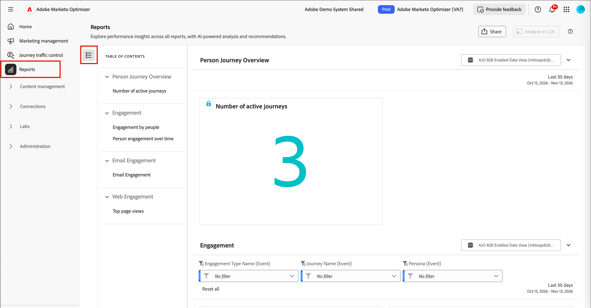
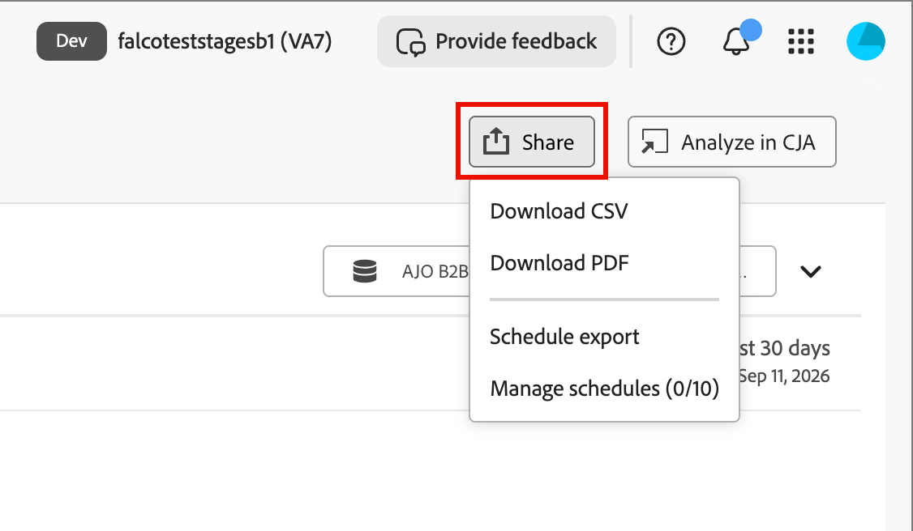
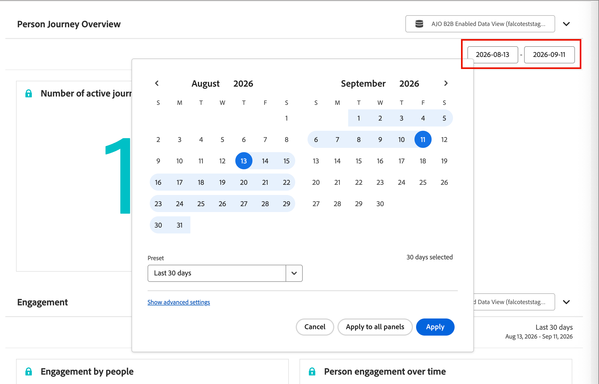

# Rapports

La page _[!UICONTROL Rapports]_ vous donne des informations sur les performances dans [!DNL Adobe Marketo Optimizer], notamment l’engagement des parcours, les performances des e-mails et l’activité web. Dans le volet de navigation de gauche, sélectionnez **[!UICONTROL Rapports]** pour l’ouvrir.

Chaque rapport est créé à l’aide des fonctionnalités [!DNL Adobe Customer Journey Analytics] et incorporé directement dans [!DNL Marketo Optimizer]. Cliquez sur l’icône _Liste_ (  ) pour utiliser le panneau **[!UICONTROL Table des matières]** sur la gauche pour passer d’une section à l’autre.

{width="800" zoomable="yes"}

>[!PREREQUISITES]
>
>Pour afficher les rapports dans l’onglet _[!UICONTROL Rapports]_, vous devez disposer de l’autorisation **[!UICONTROL Afficher les rapports incorporés B2B]** [5&rbrace;.](../start/permissions-reference.md)

## Sections du rapport {#report-sections}

L’onglet [!UICONTROL Rapports] organise les rapports préconfigurés en quatre sections. Chaque section comporte un ou plusieurs éléments téléchargeables, ainsi que sa propre page de documentation contenant des détails sur ses mesures et visualisations.

| Section | Éléments téléchargeables | Page de rapport |
| --- | --- | --- |
| [!UICONTROL Présentation Du Parcours Personne] | Nombre de parcours actifs | [Rapport de présentation du Parcours Personne](./person-journey-overview-report.md) |
| [!UICONTROL Engagement] | Engagement des personnes, engagement des personnes au fil du temps | [Rapport d’engagement](./engagement-report.md) |
| [!UICONTROL Engagement Des E-Mails] | Engagement des e-mails | [Rapport d’engagement sur les e-mails](./email-engagement-report.md) |
| [!UICONTROL Engagement Web] | Pages les plus vues | [Rapport d’engagement web](./web-engagement-report.md) |

## Rapports d’enregistrements individuels {#individual-record-reports}

Certains rapports se concentrent sur un seul enregistrement au lieu d’une vue à l’échelle de la section. Ils sont accessibles à partir d’une autre zone de l’application.

* Pour connaître les performances d’optimisation de l’heure d’envoi des e-mails, ouvrez le rapport depuis l’interface de conversation [!UICONTROL Coworker]. Pour connaître les étapes, voir [Optimisation de l’heure d’envoi des e-mails](../marketing/email-send-time-optimization.md#reporting).
* Pour en savoir plus sur les performances du parcours de personnes, ouvrez le rapport [Parcours de personnes](./person-journey-individual-report.md) depuis un parcours actif ou terminé. Après avoir ouvert le rapport, vous pouvez sélectionner plusieurs parcours à inclure.

## Exportation d’un rapport {#export-a-report}

Sélectionnez **[!UICONTROL Partager]** en haut de la page du rapport pour exporter ou planifier la diffusion de ses données.

{width="500"}

* **[!UICONTROL Télécharger CSV]** - Exportez les données du rapport sous forme de valeurs en texte brut.

* **[!UICONTROL Télécharger PDF]** - Exportez tous les tableaux et visualisations visibles du rapport en tant que fichier PDF.

* **[!UICONTROL Planifier l&#39;exportation]** - Configurez une exportation récurrente du rapport, diffusé une fois par semaine ou un mois sous la forme d&#39;un fichier CSV ou PDF.

* **[!UICONTROL Gérer les plannings]** - Examinez et gérez les exportations planifiées existantes. L’option affiche un nombre en cours d’exécution, tel que `3/10`, de plannings utilisés par rapport à la limite de votre organisation.

>[!NOTE]
>
>Votre organisation peut avoir un maximum de 10 exportations planifiées sur tous les rapports, sur une fréquence hebdomadaire ou mensuelle. Si vous n’êtes pas administrateur, vous ne pouvez gérer que vos propres exportations planifiées. Les administrateurs peuvent afficher et gérer chaque exportation planifiée dans l’organisation.

## Analyse d&#39;un rapport dans [!DNL Customer Journey Analytics] {#analyze-a-report-in-cja}

>[!AVAILABILITY]
>
>Cette fonction est disponible si votre organisation dispose d’une licence pour [!DNL Adobe Customer Journey Analytics] et que le profil de produit vous est affecté.

Sélectionnez **[!UICONTROL Analyser dans CJA]** sur n’importe quelle section de rapport pour l’ouvrir dans [!DNL Adobe Customer Journey Analytics] Workspace, où vous pouvez créer des visualisations personnalisées en plus de ce qui est disponible dans le rapport incorporé.

## Modifier la période {#change-the-date-range}

Chaque section de rapport affiche les données d’une période spécifique, dans le coin supérieur droit de la section. Cliquez dans les champs de période pour afficher les outils de sélection de dates et sélectionnez la période. Vous pouvez choisir un autre paramètre prédéfini ou définir une plage personnalisée.

{width="600"}
