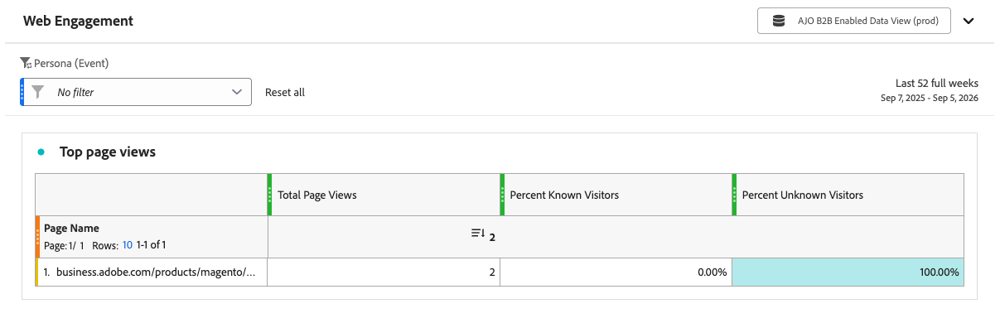
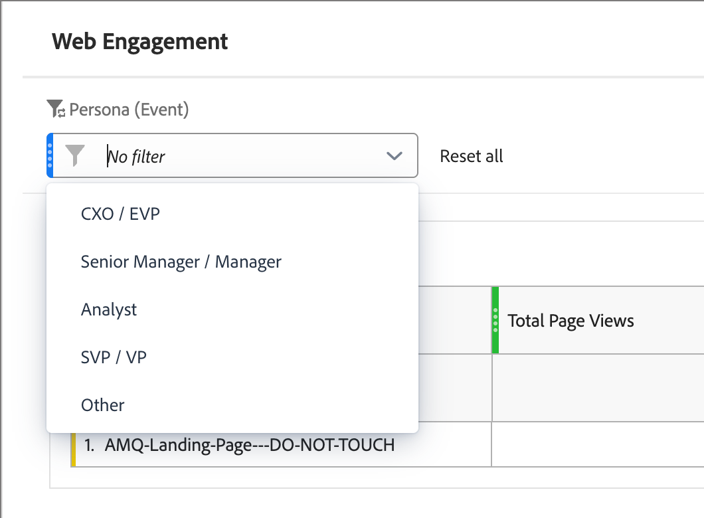

# Rapport d’engagement web

<!-- SPHR-39571: Audience, Company Name, Company Industry, and Region filters, plus the report title/subtitle rename, are planned under SPHR-32471 (not yet shipped) and should be documented separately once delivered  -->

Utilisez le rapport [!UICONTROL Engagement web] pour consulter l’engagement des webinaires interactifs les plus populaires dans votre instance.

_Afficher le rapport :_

1. Dans la navigation de gauche, sélectionnez **[!UICONTROL Rapports]**.
1. Cliquez sur l’icône _Liste_ (  ) et sélectionnez **[!UICONTROL Engagement web]** dans le panneau _[!UICONTROL Table des matières]_.

{width="700" zoomable="yes"}

Vous pouvez [modifier la période](./reports-overview.md#change-the-date-range) du rapport.

Sélectionnez **[!UICONTROL Partager]** en haut du rapport pour télécharger ou planifier l&#39;exportation de toutes les données du rapport. Voir [_Exporter un rapport_](./reports-overview.md#export-a-report) dans la présentation des rapports.

## Tableau des rapports {#report-table}

Le rapport [!UICONTROL Engagement web] affiche les 10 pages les plus consultées de votre instance, avec la dimension de ligne suivante.

* **[!UICONTROL Nom de la page]** - Nom de la page web.

| Colonne | Description |
| --- | --- |
| [!UICONTROL Nombre Total De Pages Vues] | Nombre total de vues de la page. |
| [!UICONTROL Pourcentage De Visiteurs Connus] | Pourcentage de vues de visiteurs connus. |
| [!UICONTROL Pourcentage De Visiteurs Inconnus] | Pourcentage de vues de visiteurs inconnus. |

## Filtres {#filters}

Utilisez le filtre **[!UICONTROL Persona (Événement)]** en haut du rapport pour limiter les données de page vue. Ouvrez la liste de filtres et sélectionnez les valeurs à inclure.

* **[!UICONTROL Persona (événement)]** - Filtrez par le [persona dérivé](../audiences/personas.md#filter-by-derived-persona) associé aux pages vues. La valeur par défaut est [!UICONTROL Aucun filtre].

{width="500" zoomable="yes"}

Sélectionnez **[!UICONTROL Réinitialiser tout]** pour effacer le filtre et revenir à la vue par défaut.

>[!NOTE]
>
>Des filtres pour l’audience, le nom de la société, le secteur de la société et la région sont prévus pour une version ultérieure.
